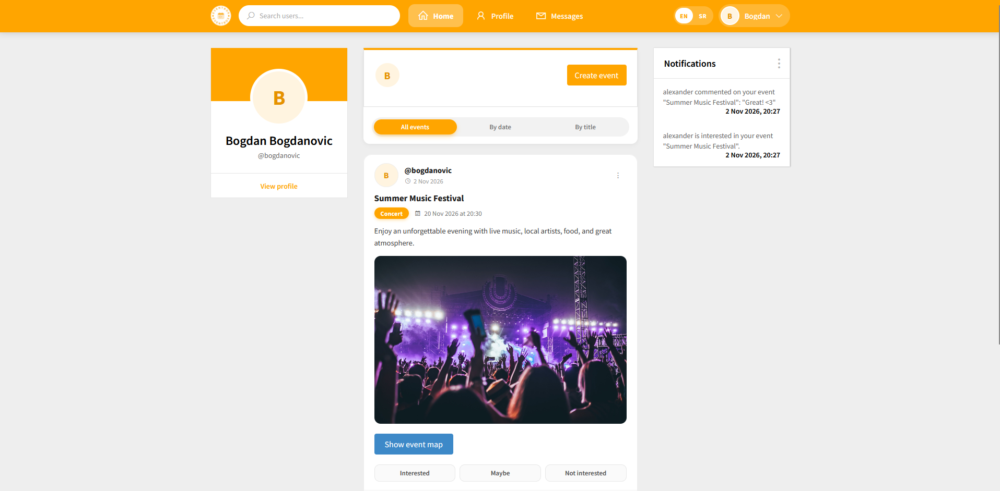
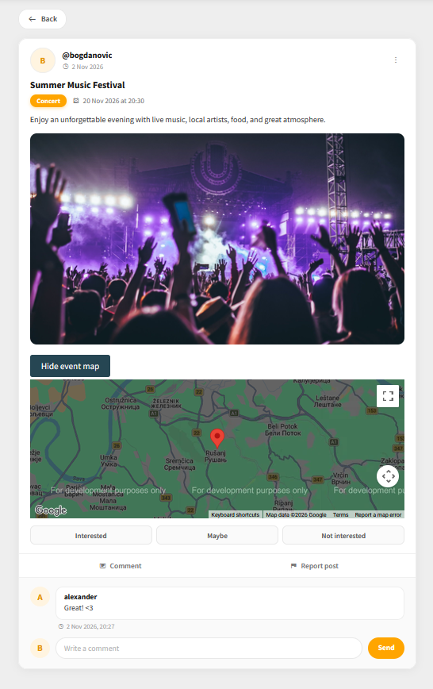
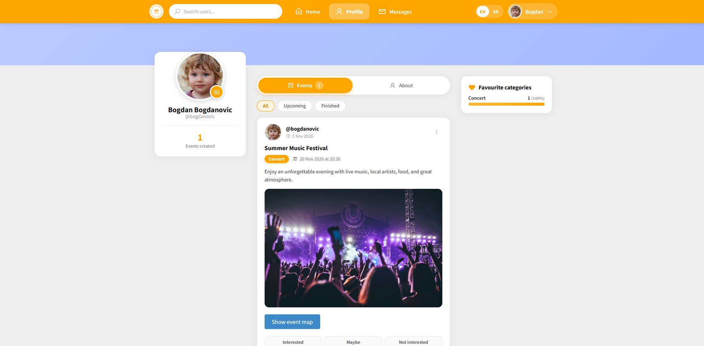
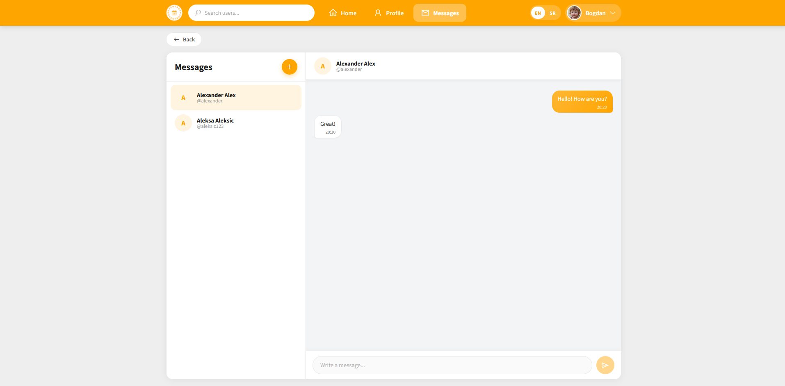
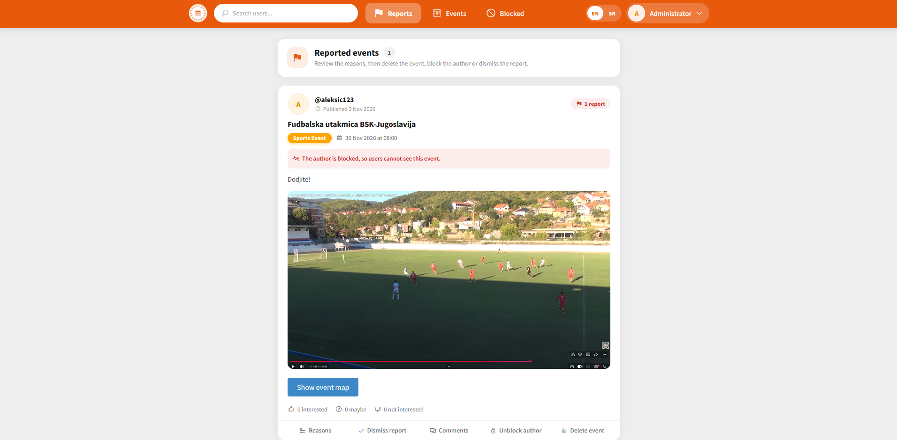
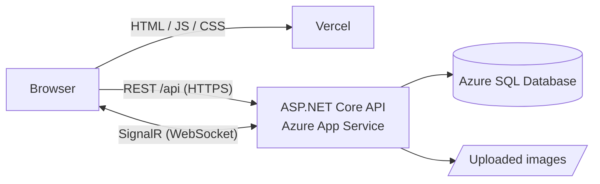

<p align="center">
  
</p>

<p align="center">
  A social network for creating, discovering and discussing local events.
  <br>
  <a href="https://eventbox-tau.vercel.app"><strong>Live demo</strong></a>
</p>

<p align="center">
  
  
  
  
  
</p>

---

EventBox lets people publish events with a location on the map, react to them, comment, chat in real time and get live notifications when someone interacts with their events. Moderators review reported content in a dedicated admin panel.

It started as a project for the _Software Engineering_ course and was later rebuilt and deployed to the cloud.

> **Note:** the demo runs on free hosting plans. After a period of inactivity the server and the database go to sleep, so the first request can take up to ~30 seconds.

## Screenshots

<!-- Add the images to docs/screenshots/ with these names -->

| Feed                               | Event                                |
| ---------------------------------- | ------------------------------------ |
|  |  |

| Profile                                  | Chat                               |
| ---------------------------------------- | ---------------------------------- |
|  |  |

| Admin panel                                | Mobile |
| ------------------------------------------ | ------ |
|  |

## Features

**Users**

- Registration and login, profile editing, profile picture, account deletion (confirmed with password)
- Events with title, category, date and time, description, image and a location picked on Google Maps
- Feed of upcoming events with infinite scroll, filtering by date or by title
- Reactions (_Interested / Maybe / Not interested_) with live counters
- Comments with editing and deleting
- Real-time notifications and one-to-one chat with unread message badges
- Reporting events that break the community rules
- User search and public profiles with favourite categories
- Responsive layout with a bottom navigation bar on mobile
- English and Serbian interface (English by default), switchable from the header; the choice is remembered

**Administrators**

- Reported events with reasons; dismiss a report or delete the event
- All events (including past ones) with search
- User overview, blocking and unblocking (blocked users' content is hidden from everyone else and restored on unblock)
- Moderation of any comment
- Managing administrator accounts

## Tech stack

| Layer    | Technologies                                                                                                           |
| -------- | ---------------------------------------------------------------------------------------------------------------------- |
| Frontend | React 18, Vite 5, React Router 6, react-i18next, SignalR client, `@vis.gl/react-google-maps`, date-fns, react-toastify |
| Backend  | ASP.NET Core 9 Web API, Entity Framework Core 9, SignalR, ASP.NET Core localization, Swagger                           |
| Database | Microsoft SQL Server (Azure SQL Database in production)                                                                |
| Hosting  | Vercel (frontend), Azure App Service (backend), Azure SQL Database                                                     |
| CI/CD    | GitHub Actions (backend), Vercel Git integration (frontend)                                                            |

## Architecture



The frontend is a static single-page app. All data comes from the REST API, and live updates (notifications and chat messages) are pushed over a single SignalR connection. The server always saves a notification or message to the database first and only then pushes it, so nothing is lost when the recipient is offline.

## Technical highlights

- **REST API** grouped by resource (`/api/users`, `/api/events`, `/api/events/{id}/comments`, ...), documented with Swagger
- **Cursor-based pagination** for every list (feed, profile, comments, chat history), with infinite scroll on the client
- **Authentication:** random 256-bit session token sent as a Bearer token, sliding 30-minute session, logout invalidates the token on the server
- **Password hashing** with PBKDF2 (ASP.NET Core Identity `PasswordHasher`)
- **Brute-force protection:** rate limiting per IP address and account lockout after 5 failed logins
- **Safe uploads:** images are validated by their file signature (JPG, PNG, WEBP, up to 5 MB) and stored under random names
- **Content Security Policy** generated from the API address at build time, CORS whitelist from configuration
- **Resilience:** EF Core retry policy for the serverless Azure SQL database that pauses when idle
- **Global error handler:** clients get a generic message and a trace ID, details stay in the server log
- **Internationalization:** UI texts live in translation files (react-i18next, with Serbian plural forms); the API returns validation and error messages in the language the client sends in `Accept-Language` (`.resx` resources)

## API overview

| Resource      | Endpoints                                                                                                                                                                                                          |
| ------------- | ------------------------------------------------------------------------------------------------------------------------------------------------------------------------------------------------------------------ |
| Users         | `POST /api/users` · `POST /api/users/login` · `POST /api/users/logout` · `GET /api/users/{id}` · `PUT /api/users/me` · `GET /api/users/search?query=` · `GET /api/users/{id}/events` · `PUT /api/users/{id}/image` |
| Events        | `GET /api/events` · `GET /api/events/by-date?date=` · `GET /api/events/search?title=` · `POST /api/events` · `GET` / `PUT` / `DELETE /api/events/{id}` · `PUT /api/events/{id}/image`                              |
| Comments      | `GET` / `POST /api/events/{id}/comments` · `PUT` / `DELETE /api/comments/{id}`                                                                                                                                     |
| Reactions     | `PUT` / `DELETE /api/events/{id}/reaction` · `GET /api/reactions/mine?eventIds=`                                                                                                                                   |
| Chat          | `GET /api/conversations` · `GET` / `POST /api/conversations/{userId}/messages` · `PUT /api/conversations/{userId}/read` · `GET /api/messages/unread-count`                                                         |
| Notifications | `GET /api/notifications` · `DELETE /api/notifications/{id}`                                                                                                                                                        |
| Moderation    | `POST /api/events/{id}/reports` · `GET /api/reports` · `DELETE /api/reports/{id}` · `PUT` / `DELETE /api/users/{id}/block` · `GET /api/users/blocked`                                                              |
| Admins        | `POST /api/admins/login` · `GET` / `POST /api/admins` · `DELETE /api/admins/{id}`                                                                                                                                  |

The full list with request and response shapes is available in Swagger (`/swagger`) when the backend runs locally.

## Project structure

```
EventBox/
├── Backend/                    ASP.NET Core Web API
│   ├── Controllers/            REST endpoints (Users, Events, Comments, Reactions, ...)
│   ├── Models/                 EF Core entities, DTOs and services
│   ├── Auth/                   token authentication, password hashing, login protection
│   ├── Repo/                   storage for uploaded images
│   ├── Resources/              API messages in English and Serbian (.resx)
│   ├── Migrations/             EF Core migrations
│   └── Program.cs              startup: services, middleware, SignalR hub
├── Frontend/                   React + Vite single-page app
│   └── src/
│       ├── Pages/              route-level pages
│       ├── components/         UI components
│       ├── i18n/               translations (en.js, sr.js) and i18next setup
│       ├── utils/              helpers (dates, events, admin)
│       ├── api.js              fetch wrapper (base URL, auth header, errors)
│       ├── auth.jsx            authentication context
│       ├── notifications.jsx   SignalR connection (notifications and chat)
│       └── useInfiniteList.js  hook for cursor-paginated lists
└── .github/workflows/          backend deployment to Azure
```

## Running locally

**Prerequisites:** [.NET 9 SDK](https://dotnet.microsoft.com/download), [Node.js 18+](https://nodejs.org), SQL Server (Express or LocalDB) and the EF Core CLI:

```bash
dotnet tool install --global dotnet-ef
```

**1. Database and backend**

The connection string is in `Backend/appsettings.json` (by default `.\SQLEXPRESS`, database `EventBoxDB`).

```bash
cd Backend
dotnet ef database update
dotnet run
```

The API runs on `http://localhost:5153` and Swagger on `http://localhost:5153/swagger`.

The first administrator is created with `POST /api/admins` from Swagger. This works only from `localhost` and only while no administrator exists; after that, new administrators are added from the admin panel.

**2. Frontend**

```bash
cd Frontend
cp .env.example .env
npm install
npm run dev
```

The app opens on `http://localhost:3000`.

### Configuration

| Variable                        | Where               | Purpose                                                           |
| ------------------------------- | ------------------- | ----------------------------------------------------------------- |
| `VITE_API_URL`                  | Frontend `.env`     | Backend address (default `http://localhost:5153`)                 |
| `VITE_GOOGLE_MAPS_API_KEY`      | Frontend `.env`     | Google Maps key for the map; the rest of the app works without it |
| `ConnectionStrings__EventBoxDB` | Backend environment | Database connection string                                        |
| `Cors__Origins__0`              | Backend environment | Allowed frontend origin                                           |
| `Uploads__Folder`               | Backend environment | Folder for uploaded images                                        |

Locally the backend reads these from `appsettings.json`; in production they are set as environment variables, so no secrets are stored in the repository.

## Deployment

- **Frontend:** Vercel builds `Frontend/` on every push to `main`. `vercel.json` rewrites all routes to `index.html` so deep links work.
- **Backend:** a GitHub Actions workflow builds the API with `dotnet publish` and deploys it to Azure App Service on every push to `main` that changes `Backend/`.
- **Database:** Azure SQL Database (serverless, free offer); schema changes are applied with EF Core migrations.

## Author

**Aleksa Cekić** · [GitHub](https://github.com/aleksacekic)
